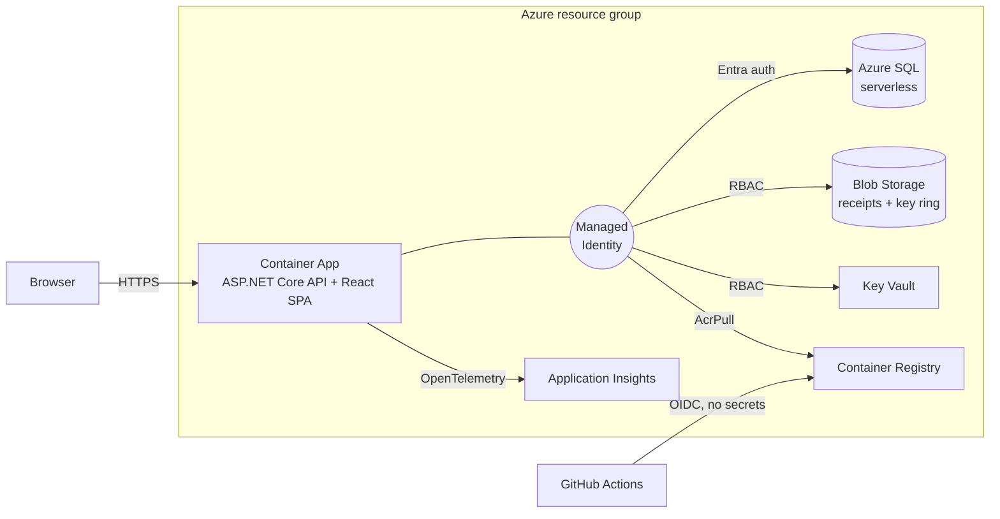

# Reno Budget Control

A renovation project manager for contractors: budgets and expenses, receipt and invoice capture with OCR,
scheduling with resource-conflict detection, materials and purchase orders, Excel/PDF reports, and an AI
assistant that works through the same data with tool calls.

**Stack:** ASP.NET Core 8 · EF Core · React 18 + TypeScript (Vite) · Playwright · Docker · Azure (Container Apps,
Azure SQL, Blob Storage, Key Vault, Application Insights) · Bicep · GitHub Actions

## Run it

| Mode | Command | Uses |
|---|---|---|
| Laptop | `cd BudgetApi && dotnet run` (+ `cd web && npm run dev`) | SQLite, local disk, Ollama |
| Cloud on a laptop | `docker compose up --build` → http://localhost:8080 | SQL Server + Azurite: the same code paths as Azure |
| Azure | `az login && scripts/azure-deploy.sh` | Everything in the diagram |

Then verify any of them with `scripts/smoke-api.sh <url>`.

The cloud design, decisions, costs and CI/CD setup are in [docs/AZURE.md](docs/AZURE.md).
